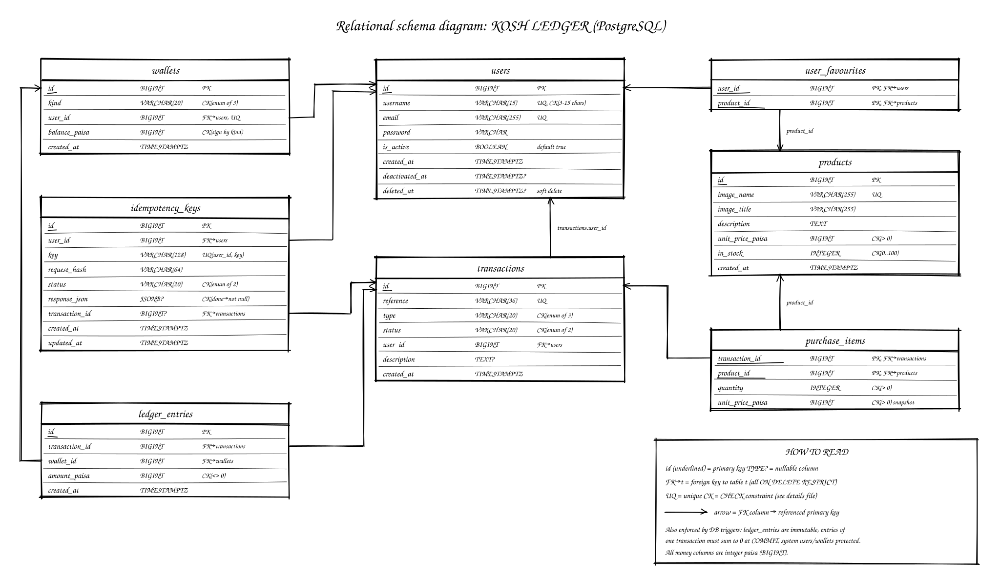

# KoshLedger

A simulated digital wallet backend in the style of eSewa or Khalti. The money is fake; the rules are not. Built to practise what breaks when requests run at the same time, when clients retry, and when a transaction fails halfway.

**Live:** [App](https://kosh-ledger-peach.vercel.app) · [API docs](https://koshledger-backend-latest.onrender.com/docs) · [Engineering blog](https://kosh-ledger-peach.vercel.app/engineering_blog)

**Stack:** FastAPI, PostgreSQL, SQLAlchemy 2.0 (async), Alembic, Pydantic v2, pytest, Docker, GitHub Actions, React + Vite + Tailwind.

> The live backend is on Render's free tier and sleeps when idle. The first request can take about a minute; the frontend shows a wake-up notice after four seconds.

## Features

- JWT auth (register, login, 30-minute tokens) with Have I Been Pwned password screening.
- One wallet per user, balances stored as integer paisa (`BIGINT`).
- Faucet: Rs 50,000 from a system treasury, 8-hour cooldown, 3 claims per rolling 24 hours.
- Transfers: up to Rs 50,000 to another active user, impossible to self-transfer.
- Shop: 18 seeded products, stock, cart purchases, price snapshots, favourites.
- Account lifecycle: deactivate, soft-delete, and recover within 30 days.
- Searchable transaction history (7/14/30 days).

## Database schema

Eight tables. Full diagrams live in [images/](images/).

| Table | Purpose |
| --- | --- |
| `users` | Credentials, account state, soft-delete timestamp |
| `wallets` | Balance cache; each row is a `user`, `treasury`, or `merchant` wallet |
| `transactions` | One row per faucet, purchase, or transfer |
| `ledger_entries` | Append-only debit/credit rows; the audit trail |
| `idempotency_keys` | Request hash, status, and stored response per `(user_id, key)` |
| `products` | Seeded catalog, price in paisa, stock |
| `purchase_items` | Transaction line items with the unit price at purchase time |
| `user_favourites` | Many-to-many favourites, composite primary key |

Integrity is enforced in the database, not only in Python:

- Wallet check constraints: user and merchant balances cannot go negative; the treasury may be negative because it funds the faucet.
- A partial unique index allows at most one treasury and one merchant wallet.
- Every transaction writes exactly two ledger entries that sum to zero. A **deferred constraint trigger** checks that sum at commit, after both rows exist.
- Ledger entries are immutable: a `BEFORE UPDATE OR DELETE` trigger rejects edits, so corrections must be compensating entries.
- Triggers protect the seeded system users and wallets from updates and deletes.

<details>
<summary>Schema diagram</summary>



</details>

## API

All routes are documented with request/response models, error codes, and idempotency behaviour at `/docs`.

| Area | Routes | Access |
| --- | --- | --- |
| Auth | `POST /auth/register`, `POST /auth/login` | Public |
| Users | `GET /users`, `GET /users/me`, `GET /users/me/transactions` | Active user |
| Account | `PATCH /users/me/change_username`, `POST /users/me/deactivate`, `POST /users/me/activate`, `DELETE /users/me/delete`, `POST /users/me/recover` | Token; activate/recover accept inactive accounts |
| Products | `GET /products`, `POST /products/choose_favourite/{id}`, `DELETE /products/remove_favourite/{id}` | Catalog public, favourites require a session |
| Money | `POST /faucet`, `POST /purchases`, `POST /transfers` | Active user + `Idempotency-Key` header |
| Health | `GET /health` | Public, no DB access |

## Reliability

- **Locking.** Money endpoints lock the wallet rows they touch with `SELECT ... FOR UPDATE` in wallet-id order, then check limits and write while the locks are held. Products are locked in product-id order before the wallets.
- **Idempotency.** Each money request inserts `(user_id, key, request_hash, in_progress)` with `ON CONFLICT DO NOTHING`. A duplicate returns the stored response, a different body returns `422`, and an unfinished first request returns `409`. A failed request rolls back its key, so it can be retried.
- **Atomicity.** Balances, stock, transaction rows, ledger entries, and the completed idempotency row commit together in one database transaction.
- **Reconciliation.** Tests assert every wallet equals its ledger sum, every transaction nets to zero, and the global ledger sums to zero.

## Tests

**245 tests** against a real PostgreSQL database, with no database mocks. SQLite cannot reproduce row locks or deferred constraint triggers, so it is not used. Only the external breach-password check is stubbed.

| File | Tests | Scope |
| --- | ---: | --- |
| `test_auth.py` | 96 | Registration rules, HIBP failure modes, JWT validation, account states |
| `test_users.py` | 50 | Profile, history filters/search, rename, deactivate/activate/delete/recover |
| `test_products.py` | 17 | Catalog, favourites, aggregate counters |
| `test_faucet.py` | 26 | Cooldown, rolling cap, idempotency, concurrency, ledger integrity |
| `test_purchases.py` | 30 | Stock and balance checks, price snapshots, replay, races |
| `test_transfers.py` | 24 | Limits, wallet capacity, self-transfer, replay, races |
| `test_reconciliation.py` | 2 | System-wide balance and ledger invariants |

The fixtures apply migrations once per session (`alembic downgrade base` then `upgrade head`), override the app's DB dependency, and reset state per test by truncating transactional tables and restoring the seeded snapshot. Concurrency tests send 10 simultaneous requests through the real endpoints.

```bash
uv run pytest -q
```

## CI/CD

GitHub Actions (`.github/workflows/build-deploy.yml`) runs on every push to `main`:

1. **Test and build.** Spin up a throwaway Postgres service, run the full suite, then build and push the Docker image tagged `latest` and with the commit SHA.
2. **Frontend check.** `npm ci` and `npm run build` before anything is deployed.
3. **Migrate.** Run `alembic upgrade head` against Neon before the new image ships.
4. **Deploy backend.** Trigger Render, wait until the deploy reports `live`, then verify `/openapi.json` and `/products` both return `200`.
5. **Deploy frontend.** Trigger the Vercel deploy hook.

The test job uses hardcoded throwaway credentials and needs no production secrets. The migration job does need the real database and treasury/merchant values, because the first migration seeds those users and embeds their emails in trigger definitions. The container never migrates on start, which avoids competing replicas.

## Project layout

```text
app/            FastAPI app, routers, models, settings
alembic/        Migration history and triggers/seed data
tests/          Integration, concurrency, and reconciliation tests
frontend/       React app (Vite, Tailwind, shadcn)
images/         ER and schema diagrams
```

## Local setup

### Prerequisites

- Python 3.14 and [uv](https://docs.astral.sh/uv/)
- PostgreSQL 16+ running on `localhost:5432` (the connection URL has no port field)
- Node.js 22+ for the frontend
- Docker (optional, for the image only)

### 1. Clone and install

```bash
git clone https://github.com/bijesh-09/KoshLedger.git
cd KoshLedger

uv python install 3.14
uv sync --locked
```

### 2. Create both databases

```bash
createdb koshledger
createdb koshledger_test
```

Tests migrate and clean the test database themselves. Both databases must exist and the credentials must be valid, because the app builds an engine at import time.

### 3. Create `.env`

All fields without a default are required; the app fails at import if one is missing.

```env
DATABASE_HOSTNAME=localhost
DATABASE_USERNAME=postgres
DATABASE_PASSWORD=postgres
DATABASE_NAME=koshledger
TEST_DATABASE_NAME=koshledger_test

SECRET_KEY=change-this-to-a-long-random-string
ACCESS_TOKEN_EXPIRE_MINUTES=30

TREASURY_EMAIL=treasury@example.com
TREASURY_PASSWORD=local-treasury-password
MERCHANT_EMAIL=merchant@example.com
MERCHANT_PASSWORD=local-merchant-password
```

The first migration seeds the treasury and merchant accounts from these values and bakes their emails into trigger definitions. Change them **before** migrating; after that, changing them requires resetting the database.

### 4. Migrate and run

```bash
uv run alembic upgrade head
uv run uvicorn app.main:app --reload --port 8000
```

This creates the schema and seeds the system accounts and the 18-product catalog. Interactive docs: <http://127.0.0.1:8000/docs>.

### 5. Run the frontend

```bash
cd frontend
npm ci
npm run dev
```

The dev server proxies `/auth`, `/users`, `/products`, `/faucet`, `/purchases`, `/transfers`, and `/health` to `127.0.0.1:8000`, so start the backend first.

### 6. Run the tests

```bash
uv run pytest -q
```

### Optional: Docker

```bash
docker build -t koshledger .
uv run alembic upgrade head          # migrate first

docker run --rm -p 8000:8000 --env-file .env koshledger
```

The image runs gunicorn (4 uvicorn workers) as a non-root user and expects `PORT` to be set, defaulting to `8000`. If Postgres runs on your host, `localhost` inside the container will not reach it: use `--network host` on Linux, or change `DATABASE_HOSTNAME` to `host.docker.internal`.
